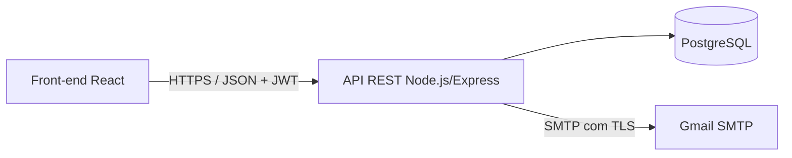
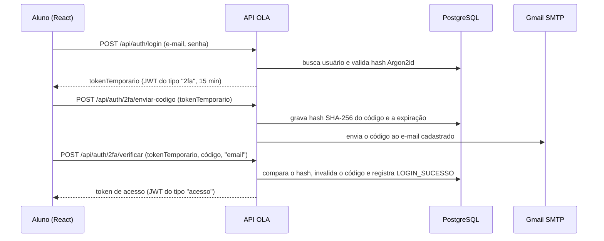

# Integração com API externa — projeto lógico e documentação

## 1. Visão geral

O OLA depende de um serviço externo, consumido exclusivamente pelo back-end
(Node.js/Express). O front-end nunca recebe credenciais desse serviço.

| Serviço | Situação | Finalidade |
|---|---|---|
| Envio de e-mail (SMTP do Gmail via Nodemailer) | Implementado | Código da verificação em duas etapas, código de recuperação de senha e e-mail de boas-vindas |

A integração de e-mail foi reaproveitada do projeto de autenticação desenvolvido
anteriormente (MVP). O login social com Google OAuth 2.0, que existia no MVP, não foi
mantido: não faz parte das telas do protótipo e exigiria credenciais adicionais do Google
Cloud.

## 2. Serviço de e-mail (implementado)

| Item | Definição |
|---|---|
| Módulo | `backend/src/services/emailService.ts` |
| Biblioteca | Nodemailer, com o serviço pré-configurado `gmail` (SMTP com TLS) |
| Autenticação | Conta Gmail e senha de app, lidas das variáveis `GMAIL_USER` e `GMAIL_APP_PASSWORD` |
| Formato | E-mail HTML com a identidade visual do OLA |
| Dados enviados | E-mail do destinatário, nome de usuário e, quando aplicável, o código de 6 dígitos. Senhas nunca são enviadas |

### Mensagens

| Função | Quando é enviada | Conteúdo |
|---|---|---|
| `enviarBoasVindas` | Após o cadastro | Confirmação da criação da conta |
| `enviarCodigo2fa` | Quando o aluno escolhe receber o código de verificação por e-mail | Código de 6 dígitos, válido por 15 minutos |
| `enviarCodigoRecuperacao` | Na etapa 1 da redefinição de senha | Código de 6 dígitos, válido por 15 minutos |

### Fluxo — verificação em duas etapas por e-mail

### Regras e tratamento de falhas

- Os códigos são gerados com gerador criptograficamente seguro, armazenados somente como
  hash SHA-256, expiram em 15 minutos e são invalidados após o uso.
- O envio é feito em segundo plano: uma falha do provedor é registrada no console do
  servidor e não interrompe a requisição do aluno.
- Sem `GMAIL_USER`/`GMAIL_APP_PASSWORD` em ambiente de desenvolvimento, o e-mail é
  simulado e o código aparece no console do back-end. Nos testes automatizados nenhum
  e-mail é enviado.
- Limites de envio da própria API (por IP, janela de 15 minutos): 3 envios de código de
  verificação e 3 solicitações de recuperação de senha.
- O Gmail aplica limites diários de envio para contas comuns; para uso em produção em
  larga escala seria necessário um provedor transacional.
